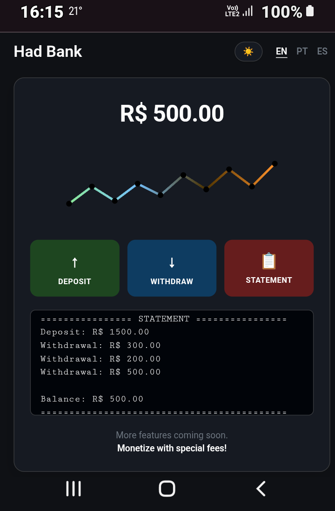

# Creating a Banking System with Python

Project developed as part of the "Potência Tech" Bootcamp, powered by iFood | Data Science, under the guidance of expert [Guilherme Carvalho](https://github.com/guicarvalho "Guilherme Carvalho").

In this project, you will have the opportunity to create a banking system using Python. The goal is to implement three essential operations: deposits, withdrawals, and account statements. The system is designed for a bank looking to monetize its operations. Throughout this challenge, you will be able to apply your Python programming knowledge to build a functional system that simulates banking transactions. Get ready to sharpen your skills and demonstrate your ability to develop practical, efficient solutions.

## Features

- **Deposit**: Adds a valid positive amount to the account balance.
- **Withdrawal**: Allows withdrawing up to R\$ 500.00 per transaction, with a daily maximum limit of 3 withdrawals, provided there is a sufficient balance.
- **Statement**: Lists all completed transactions (deposits and withdrawals) and displays the current account balance.

## Prerequisites

- Python 3.x installed on your machine.

## How to Run

1. Clone or download this repository.
2. Open your terminal or command prompt in the project directory.
3. Run the following command:

```bash
   python main.py
   ```

## Initial project structure

- `main.py`: The executable python script containing the core operational logic.

[trilha-python-dio](https://github.com/digitalinnovationone/trilha-python-dio): Repository containing all the source code developed throughout this training program;

[desafio.py](https://github.com/digitalinnovationone/trilha-python-dio/blob/main/00%20-%20Fundamentos/desafio.py): Here you can access the project in question.



[LICENSE](/LICENSE)
